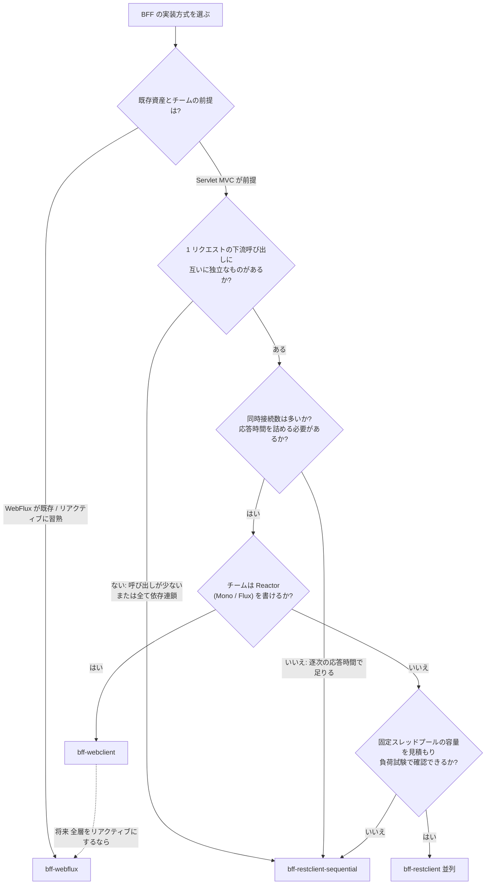

# BFF 実装方式 選択ガイド

これから BFF（Backend For Frontend: 画面向けに複数の下流 API をまとめて返す中継サーバ）を作る人が、本リポジトリの 4 方式から実装方式を選ぶためのガイドです。

この文書は次の 3 種類の記述を区別しています。

- 【コード】`src/main` を読んで確認した事実
- 【計測】本リポジトリの k6 計測で言えること（条件付き）
- 【仮説】根拠はあるが未検証のこと

## 1. 結論

- 迷ったら、まず逐次版（`bff-restclient-sequential`）で始める。一番単純で、下流が遅くなければ足りることが多い（この判断は一般論であり、本計測が直接示したものではない）。
- 下流呼び出しが複数あり、互いに独立なものがある場合は並列化の効果が大きい。本計測では、並列化した WebClient 版が逐次版の約 2.5 倍のスループット、約 40% の応答時間だった（【計測】、条件は第 3 章）。
- Servlet/MVC 資産を維持したまま並列化するなら `bff-webclient`（MVC + WebClient）。全層をリアクティブにできるなら `bff-webflux`。この 2 つは本計測で差は見えなかった（【計測】）。
- `bff-restclient`（固定スレッドプール + CompletableFuture）は、既定のプール 32 では本計測で逐次版より遅かった。追加検証では、プールが律速で、サイズを上げると解消した（N=64 で逐次版を上回る。【計測】、第 3 章「追加検証: 並列度の影響」）。プールサイズを負荷に合わせて設計し、負荷試験で確認できるなら選択肢になる。見積もれない場合は避ける（原因の見立ての限界は第 6 章）。
- この数値は 1 回・ローカル・固定遅延スタブの結果です。一般論として使わず、自分の環境で再計測してください（第 7 章）。

## 2. 4 方式の概要

どの方式も同じ API（`GET /api/dashboard/{userId}`）を提供し、下流（`backend-stub`）の user・orders・products を集約して返します。DDD + オニオンアーキテクチャ（依存を外側から内側へ向ける層構造）で構成されており、4 モジュールとも `presentation / application / domain / infrastructure` の層に分かれています。

| 項目 | bff-webclient | bff-webflux | bff-restclient（並列） | bff-restclient-sequential |
|---|---|---|---|---|
| ポート | 8081 | 8084 | 8082 | 8083 |
| 下流呼び出しの順序 | 並列（2 段） | 並列（2 段） | 並列（2 段） | 逐次 |
| サーバ側の方式 | Servlet MVC | WebFlux | Servlet MVC | Servlet MVC |
| 下流 HTTP クライアント | WebClient | WebClient | RestClient（JDK HttpClient） | RestClient（JDK HttpClient） |
| 下流 I/O | ノンブロッキング | ノンブロッキング | ブロッキング | ブロッキング |
| 並列化の手段 | `Mono.zip` と `Flux.flatMap` | `Mono.zip` と `Flux.flatMap` | `CompletableFuture.supplyAsync` + 固定スレッドプール | なし |
| リクエストスレッドの扱い | `block()` で完了まで待つ | 待たない（`Mono` を返す） | `join()` で完了まで待つ | 各呼び出しで同期的に待つ |
| 追加のスレッドプール | なし（Reactor の仕組みを利用） | なし | 固定 32 スレッド（全リクエストで共有） | なし |
| `src/main` の `.kt` ファイル数 | 19 | 19 | 19 | 19 |
| `.kt` の行数（コメント・空行を除く） | 418 | 416 | 413 | 409 |
| `.kt` の行数（コメント込み） | 770 | 769 | 783 | 746 |
| `GetDashboardUseCase.kt`（コメント・空行を除く） | 68 行 | 68 行 | 68 行 | 53 行 |
| 学習コスト（筆者の見立て。未測定） | 中〜高（Reactor の理解が必要） | 高（全層がリアクティブ） | 中（非同期の理解とプール設計） | 低 |

補足:

- 用語: ブロッキングは「応答が返るまでスレッドが待つ」こと、ノンブロッキングは「待たずに他の処理をし、完了通知を受けて続きを実行する」こと。`Mono` / `Flux` は Reactor のリアクティブ型（それぞれ 0〜1 件、0〜N 件の非同期結果）。
- 【コード】サーバ側の方式は依存スターターで決まる（`bff-webflux` は `spring-boot-starter-webflux`、他の 3 つは `spring-boot-starter-webmvc`）。`application.yml` で指定しているのはポート、下流の URL、タイムアウト（2000ms）と、`bff-restclient` のプールサイズ（32）だけで、サーバや HTTP クライアントのスレッド数・コネクションプールは変更していない（フレームワークの既定のまま）。
- 【コード】`bff-webclient` は MVC のリクエストスレッドが `block()` で待つため、下流 I/O はノンブロッキングでも、リクエストスレッドは占有される。`bff-webflux` は `block()` を使わない。
- コード量の数え方: `find <module>/src/main -name '*.kt'` の対象に対し、コメント行（`//`、`/**`、`*`）と空行を除いた行数。差はごく小さく、DDD の層構成が行数の大半を占めるため、方式の複雑さの指標としては弱い。
- 学習コストは測定したものではなく、筆者の判断です。

## 3. 実測結果

条件（すべて第 6 章の限界とセットで読むこと）:

- 負荷: k6 v2.3.0、VUS=50（同時仮想ユーザー 50、リクエスト間の待ち時間なし）、30 秒、各方式 1 回ずつ。計測日 2026-10-22。
- 対象: `GET /api/dashboard/u1`。下流は `backend-stub`（1 呼び出しあたり固定 200ms の遅延）。
- 実行: ローカル macOS、`scripts/run-compare.sh`（BFF を 1 つずつ起動して直列に計測）。
- エラー率はすべて 0%。

| 指標 | bff-webclient | bff-webflux | bff-restclient（並列） | bff-restclient-sequential |
|---|---|---|---|---|
| スループット（req/s） | 119.9 | 119.4 | 30.8 | 48.0 |
| p50 | 413ms | 413ms | 1635ms | 1029ms |
| p95 | 432ms | 435ms | 1683ms | 1093ms |
| p99 | 492ms | 467ms | 1823ms | 1212ms |

下流呼び出しは 1 リクエストあたり 5 回です。

- 【コード】user と orders を並列に取得（1 段目）し、orders の結果から商品 ID を決めて商品を取得する（2 段目）。商品は 3 件（p1, p2, p3）。合計 user 1 + orders 1 + products 3 = 5 回。
- 【コード】商品の呼び出しは orders の結果に依存するため、1 段目と 2 段目は並列化できない。

読み取れること:

- 【計測】応答時間は、遅延 200ms を基準にした理論値と近い。2 段並列なら 200ms × 2 段 = 400ms、逐次なら 200ms × 5 回 = 1000ms で、実測 p50 は 413ms（webclient / webflux）と 1029ms（sequential）。この近さは、スタブの遅延が支配的な条件であることを示す。
- 【計測】webclient と webflux はスループット・レイテンシとも差が小さく（119.9 と 119.4 req/s）、この条件では差を識別できなかった。1 回計測のため、差の有無そのものも断定できない。
- 【計測】restclient 並列は、p50 が理論値 400ms の約 4 倍の 1635ms で、逐次版よりも遅かった。原因の検証は次の「追加検証」小節と第 6 章。
- 注意: k6 は VUS=50 の閉じた負荷（リクエストを送り終えたらすぐ次を送る）なので、スループットはおおむね `VUS ÷ 応答時間` になる。webclient / webflux の 119.9 req/s は「サーバの上限」ではなく、VUS=50 のときの値であり、限界性能は測っていない。

### 追加検証: 並列度の影響

restclient 並列版を `--downstream.parallelism=N` で起動し直し、プールサイズ N を変えて再計測した。

- 【計測】条件: VUS=50、30 秒、k6、各構成 2 回、2026-10-22。全 run で失敗率 0%、checks 100%。N=32 は既定値で、2 回平均（p99 は 1863 / 1690ms）。sequential は同時計測の値。

| 構成 | スループット（req/s） | p50 | p95 | p99 |
|---|---|---|---|---|
| N=8 | 7.7 | 6.4s | 6.7s | 6.7s |
| N=32（既定） | 31.0 | 1.62s | 1.67s | 1.78s |
| N=64 | 62.1 | 805ms | 830ms | 856ms |
| N=200 | 120.4 | 412ms | 427ms | 456ms |
| sequential（同時計測） | 48.5 | 1025ms | 1061ms | 1104ms |

読み取れること:

- 【計測】スループットは、プール上限のモデル N ÷（5 呼び出し × 0.2 秒）に N=8 / 32 / 64 でほぼ一致した（モデル値 8 / 32 / 64 req/s、実測 7.7 / 31.0 / 62.1）。
- 【計測】N=200 は約 120 req/s で、VUS=50 側の頭打ち（webclient / webflux と同等）。プールの上限ではない。
- 【計測】並列が逐次より遅い逆転は N=32 で残り、N=64 で解消した。
- 【計測】N=32 の thread dump（計測中 1 回）では、プールのスレッド 32 本が全て下流 HTTP の応答待ち（WAITING）で、アイドルは 0 本。Tomcat の exec スレッド 50 本は `join` で待機していた。
- 【計測】N=8 では p50 6.4s がタイムアウト設定（`timeout-ms=2000`）を超えたが、失敗率は 0%。【コード】タイムアウトは HTTP 呼び出し単位で、プール待ちは対象外のため、利用者には 502 ではなく遅延として現れる。
- 限界: 各構成 2 回、VUS=50 固定。1 リクエストの商品呼び出し数 k=3 は推定（スタブ未確認）。キュー長・キュー待ち時間は直接観測していない。

## 4. 選択フローチャート



使い方の注意:

- これは判断の目安です。分岐の根拠のうち、本リポジトリで確認できているのは「並列化できる呼び出しがあるときの効果」（第 3 章）と「プールを使う方式に設計上の注意が要る」（第 5 章）です。「同時接続数が多いとき」「習熟度」の分岐は一般的な考え方で、本計測では検証していません。
- 「依存連鎖」とは、ある呼び出しの結果が次の呼び出しの入力になる関係です（本リポジトリでは orders → products）。

## 5. 方式ごとの向く場面 / 向かない場面 / 落とし穴

以下は【コード】で確認できた事実を中心に書いています。

### 5.1 bff-restclient-sequential（RestClient、逐次）

向く場面:
- 下流呼び出しが少ない、または全て依存連鎖で並列化できない場合。
- 追加のスレッドプールを持ちたくない場合。コードが最も短い（`GetDashboardUseCase.kt` は 53 行で、他の 3 方式より 15 行少ない）。

向かない場面:
- 独立した呼び出しが複数あり、応答時間を詰めたい場合。本計測では 5 回を直列に待つため p50 は約 1 秒だった（理論値 1000ms）。

落とし穴:
- 【コード】タイムアウトは呼び出しごと（connect / read とも `downstream.timeout-ms`、既定 2000ms）。リクエスト全体の期限はない。最悪の場合、各呼び出しのタイムアウトが積み上がる（理論上 5 回 × 2 秒）。
- 【コード】user を先に呼び、失敗したら orders 以降は呼ばない。
- 【コード】商品は注文ごとに呼ぶ（`orders.associate`）。同じ商品が複数の注文にあっても重複して呼ぶ。本計測のデータは商品が全て異なるため、この影響は出ていない。

### 5.2 bff-restclient（RestClient、固定スレッドプールで並列）

向く場面:
- ブロッキングの RestClient / 同期ライブラリを使い続けたまま、独立した呼び出しを並列化したい場合。コードは同期スタイルで読める。

向かない場面:
- プールの大きさを見積もれない場合、同時リクエスト数が読めない場合。既定の 32 では本計測で逐次版より遅かった（プールを 64 以上にすると解消。第 3 章の追加検証）。

落とし穴:
- 【コード】`Executors.newFixedThreadPool(32)`（`downstream.parallelism` の既定）を全リクエストで共有する。1 リクエストが 5 回の下流呼び出しを `supplyAsync` で投入し、各呼び出しはプールのスレッドをブロッキングで占有する。
- 【コード】`newFixedThreadPool` のキューは上限がない。タイムアウトは HTTP 呼び出しの開始後にだけ効くため、プール待ちの時間はタイムアウトで打ち切られない（待ち行列が伸びても自動では制限されない）。
- 【コード】user が失敗（404 など）しても、投入済みの orders の `Future` はキャンセルされず、プール上で完了まで動く。商品の呼び出しも同様で、1 つが失敗しても残りはキャンセルしない。
- 【コード】user を先に `await` し、その失敗を優先して投げる。orders の完了は待たない。
- 【コード】1 リクエストあたりのスレッド使用: MVC のリクエストスレッド 1 本（`join()` で待機）に加え、プールのスレッドを最大 3 本（2 段目の商品 3 件）使う。
- 【コード】商品は注文ごとに呼ぶ（重複排除なし）。
- 【計測】プールサイズ N=8 では p50 が 6.4s（タイムアウト 2000ms 超）になったが、失敗率は 0% だった。タイムアウトが HTTP 呼び出し単位でプール待ちに効かないため、プール不足は 502 ではなく遅延として現れ、エラー率の監視では気づけない（第 3 章の追加検証。2 回計測）。

### 5.3 bff-webclient（MVC + WebClient、`block()` で同期化）

向く場面:
- Servlet MVC 資産（フィルタ、例外ハンドラ、既存の同期コード）を維持しつつ、下流呼び出しをノンブロッキングで並列化したい場合。
- 本計測では、同じ条件で webflux と同等の結果だった（【計測】）。

向かない場面:
- 「リアクティブで全層を通す」ことが目的の場合（コントローラで `block()` するため）。

落とし穴:
- 【コード】コントローラが `block()` を呼ぶので、MVC のリクエストスレッドは完了まで占有される。ノンブロッキング化しているのは下流 I/O の部分だけ。
- 【コード】user と orders は `settle`（成功・失敗を値に包む）してから `Mono.zip` するため、一方が先に失敗しても他方の完了（最大でタイムアウトまで）を待つ。代わりに、どちらが失敗しても判定は決定的で、user の 404 が常に優先される。
- 【コード】商品は `distinct()` で重複排除してから `flatMap` で並列取得する。`flatMap` の並列度はコードで指定していない（Reactor の既定に従う）。
- 【コード】タイムアウトは各 `Mono` に `.timeout(Duration)`（既定 2000ms）。
- 【コード】下流が本文なしで応答するなど `Mono` が空になった場合、`block()` が `null` を返し、`requireNotNull` が例外を投げる。この例外はハンドラの対象外のため 500 になる（restclient 系は同じ状況を 502 にする）。
- 学習面: `Mono.zip` の失敗伝播（最初のエラーで残りをキャンセルする）など、Reactor の挙動を理解する必要がある。このコードに `settle` が入っているのはその対策。

### 5.4 bff-webflux（WebFlux、フルリアクティブ）

向く場面:
- 全層をリアクティブ（`block()` なし）で構成できる場合、スタックを WebFlux に揃えられる場合。

向かない場面:
- チームがリアクティブに不慣れ、またはブロッキング前提のライブラリ（同期的なクライアントなど）を多用する場合。これは一般論で、本リポジトリでは検証していない。

落とし穴:
- 【コード】集約ロジックは webclient 版と同じ（`Mono.zip` + `flatMap`）。差はコントローラが `Mono` を返し、`block()` しない点。
- 【コード】`Mono` が空になった場合は 500 でも 502 でもなく、空の応答になる（コードのコメントに「空応答を明示的なエラーにはしていない」とある）。実際のステータスは未確認。
- 【コード】入力の検証（不正な userId）も `Mono` の中で 404 に変換している（`Mono.fromCallable` + `onErrorMap`）。

### 5.5 共通のエラー変換（4 方式とも）

| 状況 | 結果 | 【コード】の根拠 |
|---|---|---|
| user が下流で 404、または userId が不正 | 404 `{"error":"user not found: <id>"}` | 各 `ErrorTranslator` と例外ハンドラ |
| 下流の 5xx・タイムアウト・接続失敗 | 502 `{"error":"downstream service unavailable"}` | 同上 |
| orders / 商品が下流で 404 | 502（404 にはならない） | user の 404 だけを `UserNotFoundException` に変換している |
| user の失敗と orders の失敗が同時 | 404 が優先 | webclient / webflux は `settle` で、restclient は user を先に `await` で、sequential は user を先に呼ぶことで実現 |

- 部分失敗（商品の一部だけ失敗）は、どの方式も一部だけ返さず全体を 502 にする。部分成功を許す設計にはなっていない。
- 4 方式のタイムアウト・例外の挙動は、本稿では実行して確認していない（コードの読解のみ）。

## 6. 本計測の限界と注意

数値を一般論にしないでください。

- 単一回計測: 各方式 1 回ずつ（30 秒）。ばらつきや再現性は未確認。差が小さい webclient と webflux の優劣は判定できない。
- 環境: ローカル macOS 1 台。BFF、スタブ、k6 が同じマシンで動いており、CPU やメモリを共有している。ネットワーク遅延はほぼない。
- 下流は固定遅延: 1 呼び出しあたり約 200ms（`Thread.sleep`）の固定遅延を返すスタブ。実環境の遅延の揺らぎ、遅い呼び出しの混在、失敗は含まれない。
- 負荷は VUS=50 のみ: 他の同時接続数での挙動、限界性能、スケールの傾向は測っていない。リクエスト間の待ち時間もない閉じた負荷である。
- DB・認証・ログ出力量などなし: 実システムの処理は含まない。1 リクエスト 5 回の呼び出し構造も、実システムとは異なりうる。
- 下流（スタブ）側の影響: スタブは MVC で `Thread.sleep` している。スタブ自体のスレッド数が結果に影響した可能性は排除していない（スタブのスレッド設定は変更していない）。
- restclient 並列が逐次より遅い原因は、追加検証で支持された（第 3 章「追加検証: 並列度の影響」）。ただし限界: 各構成 2 回のみ、キュー長・キュー待ち時間は未観測、商品数 k=3 は推定。
  - 【計測】仮説「固定プール 32 の枯渇が原因」は支持される: 32 ÷ 0.2 秒 ÷ 5 回 = 32 req/s のモデルに N=8 / 32 / 64 で実測がほぼ一致し、N=32 の thread dump ではプールのスレッドが全て下流応答待ちだった。N=64 で逆転は解消した。
  - 残る限界: プール待ちを直接観測したのは thread dump 1 回のみ。JDK HttpClient の特性や同一マシンの CPU 競合など、他の要因を完全には排除していない。
  - 検証案（実施済み）: `java -jar bff-restclient/build/libs/bff-restclient.jar --downstream.parallelism=N` で N=8 / 32 / 64 / 200 を再計測した（第 3 章）。キュー長の観測は未実施。
- オニオン化の前後の比較はしていない: 数値はオニオン化（DDD + onion architecture への再構成）後のものだけ。
- 仮想スレッド（Java 21 以降）は対象外: 本プロジェクトは JVM 17（`build.gradle.kts` の toolchain 17）のため、仮想スレッドを使った方式は測っていない。
- 学習コストの欄は筆者の見立てで、測定値ではない。

## 7. 自分の環境で確かめる手順

前提: Java 17、k6（`brew install k6`）、curl、`lsof`。Gradle は同梱のラッパー（`./gradlew`）を使います。

基本の実行（既定: VUS=50、30 秒）:

```sh
scripts/run-compare.sh
```

スクリプトは、4 つの BFF の bootJar とスタブをビルドし、スタブを起動した後、BFF を 1 つずつ起動して k6 で計測し、停止します。ポート 9090 / 8081 / 8082 / 8083 / 8084 が空いている必要があります。

環境変数:

| 変数 | 既定値 | 内容 |
|---|---|---|
| `VUS` | `50` | 同時仮想ユーザー数（正の整数） |
| `DURATION` | `30s` | 計測時間 |
| `K6_SUMMARY_TREND_STATS` | `avg,min,med,max,p(90),p(95),p(99)` | k6 のサマリに出す統計値 |
| `SKIP_K6` | 未設定 | `1` でビルド・起動・疎通確認だけ行い、k6 は実行しない |

例:

```sh
# 同時接続数を変えて比較する（VUS を変えると並列プールの影響も変わりうる）
VUS=10 scripts/run-compare.sh
VUS=200 DURATION=60s scripts/run-compare.sh

# サマリの統計値を変える
K6_SUMMARY_TREND_STATS="avg,med,p(95),p(99),max" scripts/run-compare.sh
```

結果:

- 結果は `build/load-results/<モジュール名>.json`（k6 の `--summary-export`）。起動ログは `build/load-logs/`。
- 1 回の計測では揺らぎが分からないので、同じ条件で複数回実行して比較してください。
- 自分のシステムに近づけるには、`backend-stub` の遅延（`backend-stub/src/main/resources/application.yml` の `stub.delay-ms`、または API の `?delayMs=`）や、下流の呼び出し構造を実システムに合わせてから計測してください。
- k6 スクリプトだけを単独で実行する場合は、リポジトリの `README.md`（「負荷計測」節）を参照してください。
