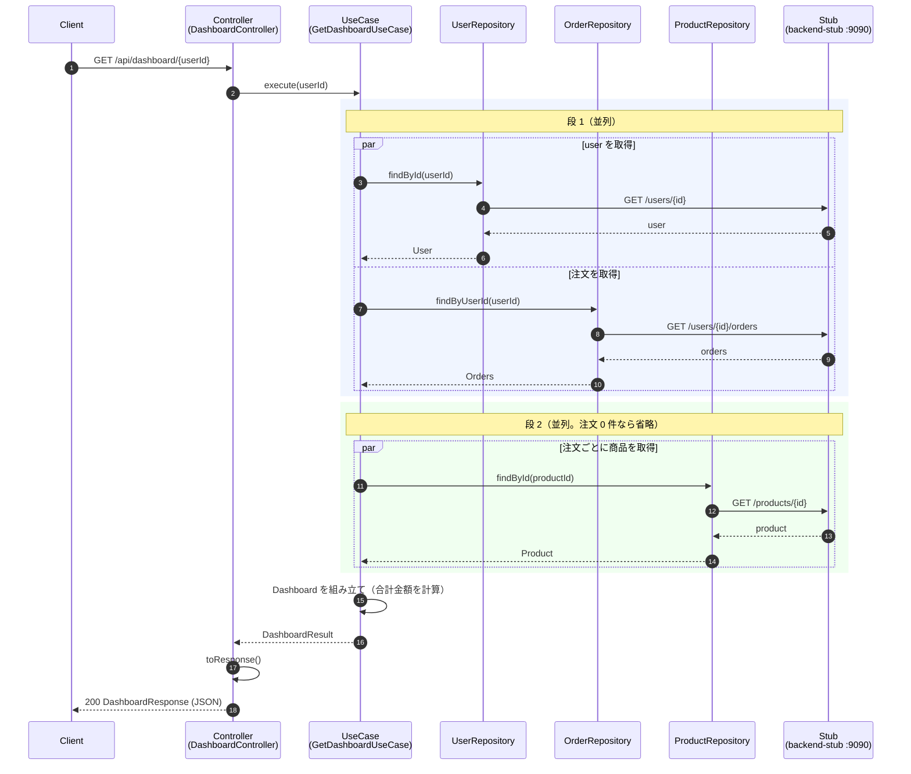

# ダッシュボード API の処理フロー

`GET /api/dashboard/{userId}` が呼ばれてから応答を返すまでの処理を説明します。対象は 4 つの BFF（`bff-webclient` / `bff-webflux` / `bff-restclient` / `bff-restclient-sequential`）のうち、並列実装の 2 方式（`bff-restclient` と `bff-webflux`）の違いを中心に書きます。

- BFF のポート: restclient 8082、webflux 8084（それぞれの方式の詳細は [README](../README.md) と [実装選択ガイド](bff-selection-guide.md) を参照）
- 下流（`backend-stub`）のポート: 9090

## 1. 概要

- 下流は 3 種類: user（`GET /users/{id}`）、orders（`GET /users/{id}/orders`）、products（`GET /products/{id}`）
- 下流呼び出しは 2 段に分かれる
  - 段 1（並列）: user と orders
  - 段 2（並列）: 注文ごとの product
- 応答は user・注文一覧（商品情報つき）・合計金額（`totalAmount`）

## 2. 正常系シーケンス

段 1 と段 2 は `par` で並列を表しています。段 2 は注文が 0 件のとき発生しません。

## 3. 段階の説明

| 段階 | 処理 | 備考 |
|---|---|---|
| Controller | `DashboardController.getDashboard` が `userId` を受け取る | 空白のみの `userId` は下流を呼ばず 404 |
| UseCase | `GetDashboardUseCase.execute` が全体を制御 | |
| 段 1 | `UserRepository.findById`（`GET /users/{id}`）と `OrderRepository.findByUserId`（`GET /users/{id}/orders`）を並列実行 | |
| 段 2 | 注文ごとに `ProductRepository.findById`（`GET /products/{id}`）を並列実行 | 注文 0 件なら発生しない |
| 組み立て | Dashboard を作る。合計金額 = Σ(price × quantity) | stub の値では 9600 |
| 応答 | `DashboardResult` → `toResponse()` → `DashboardResponse`（JSON, 200） | |

## 4. 異常系

両実装で共通の仕様です。

| 条件 | HTTP ステータス | ボディ |
|---|---|---|
| 空白のみの `userId`（下流は呼ばない） | 404 | 未確認 |
| user の下流が 404 | 404 | `{"error":"user not found: <id>"}` |
| 注文・商品の下流が 404 | 502 | `{"error":"downstream service unavailable"}` |
| 下流が 4xx / 5xx を返す | 502 | `{"error":"downstream service unavailable"}` |
| タイムアウト・接続失敗 | 502 | `{"error":"downstream service unavailable"}` |
| 空ボディ（2xx で本文なし） | 502 | `{"error":"downstream service unavailable"}` |
| 必須項目の欠落・値検証の失敗 | 502 | `{"error":"downstream service unavailable"}` |
| 想定外の例外 | 500 | 未確認 |

- 502 の詳細は WARN ログに出力されます（応答ボディには含まれません）。
- 500 のボディは本書の根拠コードでは確認していません。

## 5. restclient と webflux の違い

| 項目 | bff-restclient | bff-webflux |
|---|---|---|
| 下流呼び出しの実装 | `RestClient`（同期） | `WebClient`（`Mono`） |
| 並列化の手段 | `CompletableFuture.supplyAsync` + `join()` | `Mono.zip`（段 1）、`Flux.flatMap`（段 2） |
| 商品呼び出しの重複 | 同じ `productId` も呼ぶ | `distinct` で 1 回だけ呼ぶ |
| user が 404 のとき | 即座に 404 を返す | orders の完了（またはタイムアウト）を待ってから 404 を返す |
| 商品 1 件が失敗したとき | 残りの呼び出しは走り続ける | 残りはキャンセルされると考えられる（推測。コードに明記なし） |
| 例外変換 | `infrastructure/client/DownstreamErrorTranslator.kt`（`downstreamCall` / `userCall`）、`presentation/GlobalExceptionHandler.kt` | `infrastructure/client/WebClientRepositories.kt`、`infrastructure/client/DownstreamErrorTranslator.kt`（`failIfEmptyBody`）、`domain/exception/DomainException.kt`（`toDomainFailure`）、`presentation/BffExceptionHandler.kt` |

## 6. 実行モデルの補足

### bff-restclient

- `Executors.newFixedThreadPool(32)` の固定スレッドプールを全リクエストで共有する（`downstream.parallelism` で指定。`application.yml`）。キューは無制限。
- `CompletableFuture.supplyAsync` + `join()` のため、Tomcat のリクエストスレッドは完了まで待機（ブロック）する。
- タイムアウトは各 HTTP 呼び出しに個別に掛かる（既定 2000ms、connect / read）。プール待ちの時間はタイムアウトに含まれない。
- 最悪の待ち時間は約 2 × timeout（プール待ちを除く）。

### bff-webflux

- 戻り値は `Mono` のまま組み立て、`block()` を呼ばない。
- 段 1 は `Mono.zip`、段 2 は `Flux.flatMap` で並列化する。
- 各 `Mono` に `.timeout` を設定する。
- `flatMap` の同時実行数は Reactor の既定値に従う（推測では 256。未確認）。

## 7. 未確認事項

- ボディ転送の途中でハングした場合に timeout が効くかは未検証（`DownstreamConfig.kt` 41 行目に未検証と明記）。
- `flatMap` の同時実行数の既定値（上記の 256 は推測）。
- 失敗時に内部の購読がキャンセルされるかどうか（webflux の商品失敗時の挙動を含む）。
- 空白のみの `userId` に対する 404 のボディ。
- 想定外の例外（500）のボディ。
